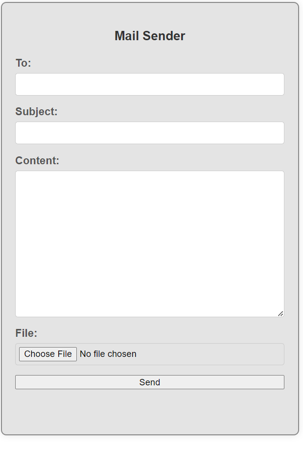

<!-- ═══════════════ HEADER ═══════════════ -->


<div align="center">


<br/>

**One clean page to write an email, attach your files and send it: built for job hunting and quick outreach.**

[Overview](#-overview) · [Features](#-features) · [Screenshot](#-screenshot) · [How it works](#%EF%B8%8F-how-it-works) · [Getting started](#-getting-started) · [Contact](#-contact)

</div>

---

## ✉️ Overview

**Mail Sender** is a full-stack web application with an **Angular** frontend and a **.NET** backend.

I built it for a real need: when you're **looking for a job**, you send the same kind of email, with your CV attached, to many companies. Mail Sender puts the whole task on **one simple page**. Enter the recipient, subject and message, attach your files, and press send. The .NET backend delivers the email through SMTP using **MailKit** and **MimeKit**.

<table>
<tr>
<td align="center" width="25%">📝<br/><b>Compose</b><br/><sub>Recipient, subject, message</sub></td>
<td align="center" width="25%">📎<br/><b>Attach</b><br/><sub>CV, portfolio or any file</sub></td>
<td align="center" width="25%">🚀<br/><b>Send</b><br/><sub>Delivered via SMTP</sub></td>
<td align="center" width="25%">⚡<br/><b>One page</b><br/><sub>No switching between screens</sub></td>
</tr>
</table>

---

## ✨ Features

<table>
<tr>
<td width="50%" valign="top">

### 🎨 Angular frontend
- Single interactive page with an easy-to-use form
- Fields for **recipient email**, **subject** and **message body**
- **File attachments**
- Talks to the backend over HTTP

</td>
<td width="50%" valign="top">

### ⚙️ .NET backend
- Receives the email request from the frontend
- Builds the message (body and attachments) with **MimeKit**
- Sends it through your **SMTP** server with **MailKit**
- SMTP settings kept in configuration, not in code

</td>
</tr>
</table>

### 💡 Use cases
- 💼 Sending your **CV to companies** while job hunting
- 🤝 Reaching out to **people you want to contact**
- 📨 Any quick email with attachments, without opening a full mail client

---

## 📷 Screenshot

<div align="center">

</div>

---

## ⚙️ How it works

```
┌──────────────────────┐     HTTP (form data     ┌──────────────────────┐      SMTP      ┌──────────────┐
│   Angular frontend   │      + attachments)     │     .NET backend     │ ─────────────▶ │  Mail server │
│                      │ ──────────────────────▶ │                      │                │  (e.g. Gmail)│
│  • To / Subject      │                         │  • MimeKit: builds   │                └──────┬───────┘
│  • Message body      │ ◀────────────────────── │    the message       │                       │
│  • Attachments       │     success / error     │  • MailKit: sends it │                       ▼
└──────────────────────┘                         └──────────────────────┘                  📬 Recipient
```

1. You fill in the form and attach files in the **Angular** page.
2. The page sends the data to the **.NET** API.
3. **MimeKit** builds the email with its attachments.
4. **MailKit** connects to the SMTP server and sends it.
5. The page shows whether it was sent.

---

## 🚀 Getting started

### Requirements
- **Node.js** and the **Angular CLI**
- **.NET SDK**
- An SMTP account. With Gmail, use an **App Password**, not your normal password.

### 1) Backend (.NET)

Add your SMTP settings to `appsettings.json` (or, better, to **user secrets** so the password is never committed):

```json
"SmtpSettings": {
  "Host": "smtp.gmail.com",
  "Port": 587,
  "UserName": "your-email@gmail.com",
  "Password": "your-app-password"
}
```

```bash
cd <backend-folder>
dotnet restore
dotnet run
```

### 2) Frontend (Angular)

```bash
cd <frontend-folder>
npm install
ng serve        # open http://localhost:4200
```

Set the backend URL in the Angular environment / service file so it points to the running .NET API.

> 🔒 Never push real SMTP passwords to GitHub. Keep them in user secrets or environment variables.

---

## 🧰 Tech stack

| Layer | Technology |
|---|---|
| Frontend | **Angular**, TypeScript, HTML, CSS |
| Backend | **.NET** (C#) Web API |
| Email | **MimeKit** (build messages), **MailKit** (send via SMTP) |

---

## 🗺️ Roadmap ideas

- [ ] Send to **several recipients** at once
- [ ] Save **email templates** (e.g. a job-application template)
- [ ] **History** of sent emails
- [ ] Rich-text editor for the message body

---

## 📬 Contact

<div align="center">

<a href="https://www.linkedin.com/in/ahmed-toba-7378b0206/"></a>
<a href="mailto:ahmedtobashahban21@gmail.com"></a>

<br/><br/>

<sub>Built by <a href="https://github.com/ahmedtobashahban21">Ahmed Toba Shaban</a></sub>

</div>


